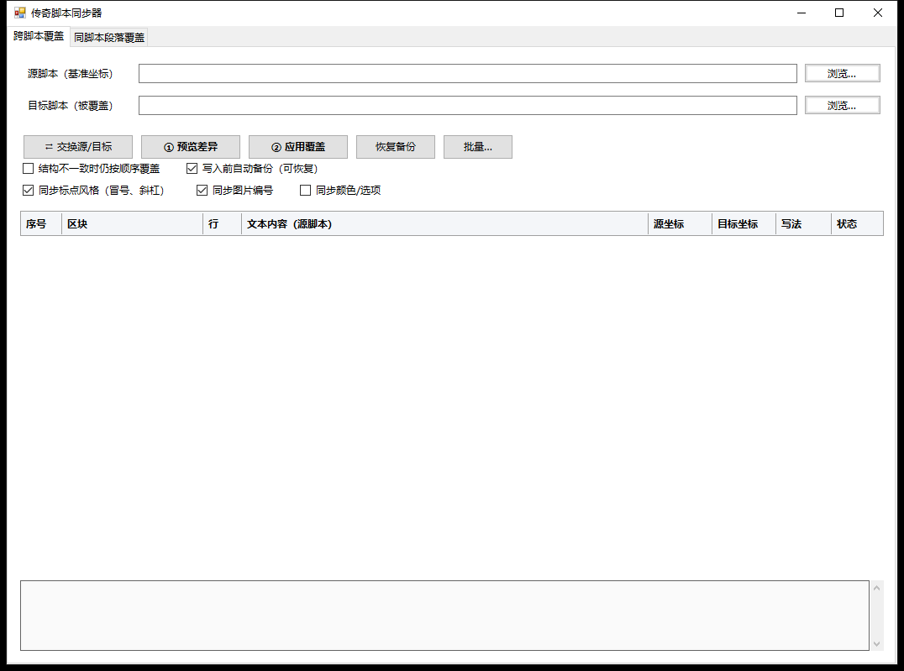
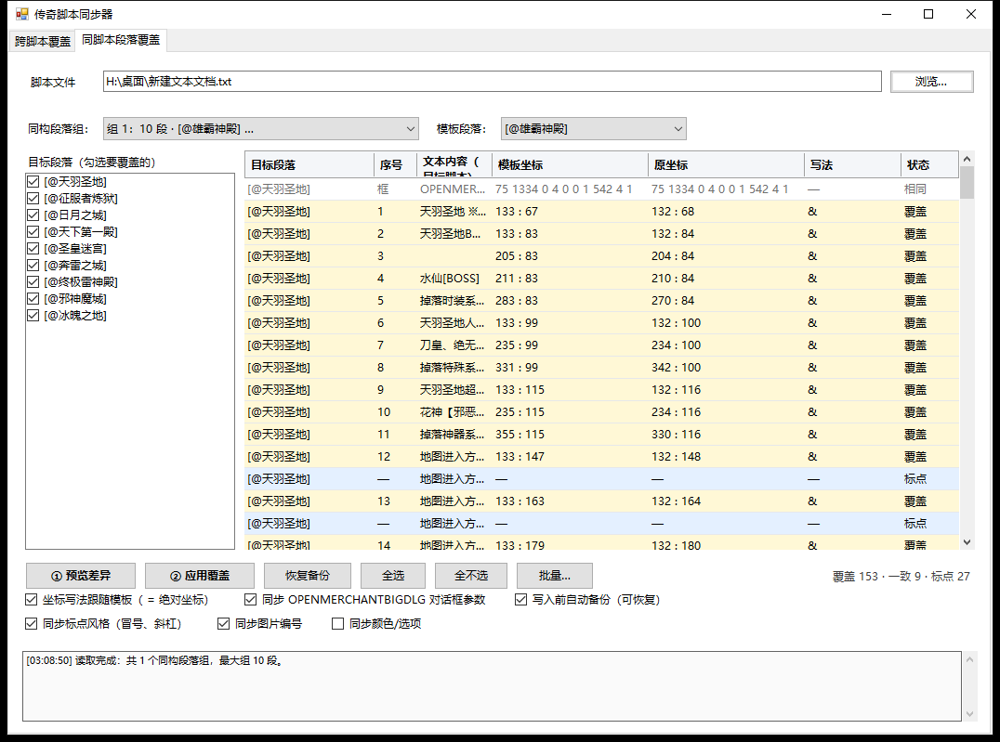
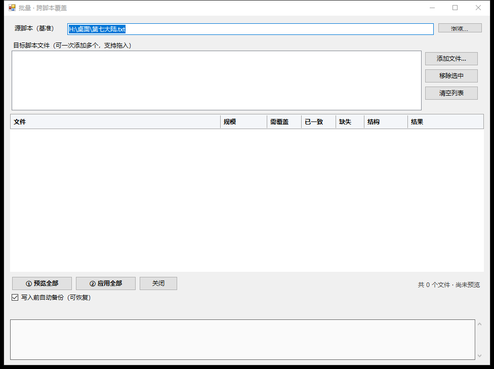
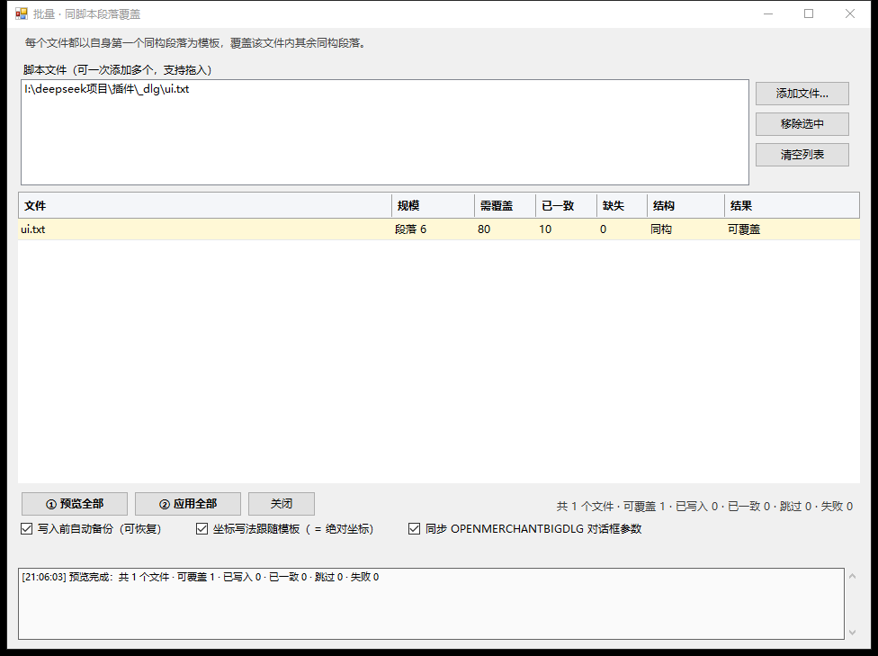

# 传奇脚本同步器

给「脚本编辑器」（LegendTools / 传奇脚本编辑器）配的**段落同步工具**，两种模式，都支持**批量**：

| 模式 | 用途 | 批量方式 |
| --- | --- | --- |
| **跨脚本同步** | 把源脚本（模板）的坐标、写法、标点同步到另一个脚本的对应位置。 | 一个源 → 多个目标文件 |
| **同脚本段落同步** | 找出脚本内结构相同的重复段落，用第一个改好的段落当模板，同步后续段落。 | 多个脚本，每个文件各用自己的首段作模板 |

同步的内容：坐标、`&` 绝对坐标写法、文字按钮/图像按钮、`OPENMERCHANTBIGDLG` 参数、
内容标点风格、图片编号、颜色选项（可选）。文字内容本身不复制，各页文案保持原样。





## 下载

- 直接运行：`dist\传奇脚本同步器.exe`（Windows，依赖系统自带 .NET Framework 4.x）
- 更新记录：[CHANGELOG.md](CHANGELOG.md)
- 自行编译：`powershell -ExecutionPolicy Bypass -File .\src\build.ps1`

---

## 1. 为什么是独立小窗口

`I:\脚本编辑器` 是闭源的 .NET 程序，内部只有 `M2桥接插件\scripts`、`脚本编辑器\tools` 等数据目录，
**没有对外开放的插件接口**（程序集里没有插件/扩展加载点）。
所以这里做的是一个可直接双击运行的配套窗口：和脚本编辑器并排开着用，不修改编辑器本体，也不碰它的配置。

## 2. 跨脚本同步

1. 双击 `dist\传奇脚本同步器.exe`，第一个页签。
2. 选 **源脚本（模板）** 和 **目标脚本**（文件可直接拖进输入框）。
3. **① 预览差异** → 表格逐行列出「源 → 目标」：黄色=要改，灰色=本来就一致，蓝色=标点/编号/颜色，红色=缺配。
4. **② 应用覆盖** → 自动备份后写入，并立刻回读校验。
5. 方向反了点 **⇄ 交换源/目标**；写错点 **恢复备份**。

匹配方式：按 `[@标签]` 区块顺序，再按区块内控件的出现顺序一一对应。
两个脚本地图名不同没关系；区块数或控件数对不上时默认拒绝写入。

三个新开关（默认：标点开、编号开、颜色关）：

- **同步标点风格**：统计模板段落内容文字里 `：`/`:`、`／`/`/` 哪种多，
  目标对应文字统一成该风格；模板没出现或打平就不改。语法位置的半角符号永远不动。
- **同步图片编号**：``、`<&imgex:75:1396:1397:1398:…>` 里坐标之前的编号跟模板。
- **同步颜色/选项**：`/FCOLOR=`、`{AUTOCOLOR=}`、`/SCOLOR=` 跟模板；`@跳转` 始终保留目标自己的。

## 3. 同脚本段落同步

1. 切到 **同脚本段落同步** 页签，选脚本文件（例如 `11.txt`）。
2. 工具自动找出**同构段落组**（同样的分行、每行控件数、空文字位置、`@跳转` 位置）。
3. 选 **模板段落**（默认组内第一个，也就是你已经改好的那段），左侧勾选要同步的段落。
4. **① 预览差异** → **② 应用覆盖**。

上面三个开关同样适用于本页签。

### “段落”是怎么切的

不只是 `[@标签]` 区块——同一个 `[@]` 里可以塞很多页对话框，每页以 `#IF` 开头：

```
[@突破鬼界境界]
  #IF EQUAL U240 33 … #SAY …      ← 第 1 页
  #IF EQUAL U240 34 … #SAY …      ← 第 2 页
  #IF EQUAL U240 35 … #SAY …      ← 第 3 页
```

工具会把每个 `#IF` 到下一个 `#IF` 之间切成一页，段落名显示成 `[@突破鬼界境界] #1`、`#2`……
所以一个区块里有几十页重复对话框也能全部识别出来，第 1 页就是默认模板。

`#SAY` 和 `#ELSE SAY`（`#elsesay`）里的内容都会被当作对话框正文；
只在 `#ACT` 里出现的命令不会被误算成文字。

### 结构只差一两个控件也能归组

重复页之间常常有一点小差异，例如：

```
[@传送鬼界]  <&Text:…:180:129><&Text:灵虚六重天:300:129><&Text:,你当前无法传送你过去:366:129>
[@传送仙界]  <你鬼界修仙境界未达到/…><元化九重天/…>,<无法传送你过去/…>
```

行数一样、控件数只差 1~2 个、文字又高度相似时，工具会把它们并入同一组（近似归组），
再按行用文字相似度对齐后补全坐标。组内仍按文档顺序排，第一段就是默认模板——
所以把你改好的那段放在最前面，就能一次带动后面所有近似页。

> 残缺标签（例如漏了 `<` 的 `,>无法传送你过去/FCOLOR=215>`）不会被当作纯文字改写，避免改坏脚本。

### 能识别哪些控件

对话框里不只有 `<&Text:…>`，本模式按**全部控件**统计结构，所以写法不同的段落也能归到一组：

| 写法 | 说明 |
| --- | --- |
| `<&Text:文字:X:Y/颜色>` | 命名文本，带绝对坐标 |
| `<文字/颜色>`、`<文字/@跳转>` | 简写文本，本身没有坐标 |
| 标签外的纯文字（如 `<一个/FCOLOR=215>。` 里的 `。`） | 没有标签、没有坐标，按一个控件计数 |
| ``、`<&imgex:…>` | 图片 / 图片按钮 |
| `<ITEMBOX:…>` | 装备框（坐标格式暂不识别，会显示「跳过」） |

`<&Text:激发所需金币<$STR(N$…)>:90:201>` 这种**文字里套变量**的写法也能正确取到 `90:201`——
旧版正则会在变量的 `>` 处提前截断，导致坐标丢失。

### 简写文本补全

模板里是 `<&Text:文字:90:105/FCOLOR=215>`、目标里是 `<文字/FCOLOR=215>`（没有坐标）时，
默认会把它**补全**成 `<&Text:文字:90:105/FCOLOR=215>`：文案、颜色、跳转都用目标自己的，
只补上 `&Text:` 前缀和模板的坐标。

纯文字同理：`<一个/FCOLOR=215>。` 里的 `。` 会变成 `<&Text:。:288:240>`，
预览表写法列显示「文本 → &Text」。两种补全的状态都显示「补全」。

这个行为跟随 **「坐标写法跟随模板」** 勾选项：取消勾选就只处理本来就有坐标的控件。

### 文字按钮 → 图像按钮

模板里把文字按钮换成了图像按钮时，只要两边都带 `@跳转`，工具会把目标按钮**整体替换**成模板的按钮，
但**保留目标自己的 `@跳转`**（每页跳转目标不同，不能照搬模板的）：

```
模板：<&imgex:75:1396:1397:1398:249:360/@灵虚7雷劫传送>
目标：<&Text:我已经准备好了:265:370/@灵虚8雷劫传送>
结果：<&imgex:75:1396:1397:1398:249:360/@灵虚8雷劫传送>
```

图像编号、按钮坐标取自模板，`@灵虚8雷劫传送` 保持目标原来的。预览状态显示「替换」，写法列显示「按钮 → imgex」。

目标写成简写 `<我已经准备好了/@元婴2雷劫传送>`（没有 `<Text:` 前缀）也可以；
页与页之间因为 `<一个/…>。` 这类纯文字「。」多出几个控件，也不会影响归组和替换。

### 关于 `&`（重点）

脚本里坐标有两种写法：

- `<&Text:文字:X:Y>` —— `&` 表示坐标按**绝对值**定位；
- `<Text:文字:X:Y>` —— 没有 `&`，同样的数字会被当成非绝对位置处理，排版就跑偏了。

所以本模式默认勾选 **「坐标写法跟随模板（& = 绝对坐标）」**：

- 模板是 `<&Text:…>`、目标是 `<Text:…>` → 自动补上 `&`；
- 模板是 `<Text:…>`、目标是 `<&Text:…>` → 也会去掉 `&` 保持一致。

预览表「写法」列会显示 `无 → &`、`& → &` 之类的变化。只想改数字就取消勾选。

### 关于 OPENMERCHANTBIGDLG（自定义对话框）

重复段落开头通常都有一句：

```
OPENMERCHANTBIGDLG 75 1334 0 4 0 0 1 542 4 1
```

第一个数字是**对话框/背景编号**，最后几个数字是**对话框坐标**。各段如果写得不一样，
同样的排版就会跑进不同的框里、位置也不齐。

本模式默认勾选 **「同步 OPENMERCHANTBIGDLG 对话框参数」**：把模板段落的整串参数
（对话框编号 + 坐标）原样写到其余段落，**只替换参数，命令本身和行尾注释都不动**。

预览表里会出现一行：序号 `框`、内容 `OPENMERCHANTBIGDLG`、模板坐标/原坐标分别是两边的参数串，
对不上的显示为「覆盖」。不想同步时取消勾选即可。

只处理两边都存在的命令；目标段落比模板多出来的命令会保留并在日志里提示。

## 4. 批量处理

每个页签的操作条上都有 **「批量…」** 按钮，点开是批量窗口。





**批量跨脚本**
- 顶部选一个 **源脚本（基准）**，下面把要处理的目标脚本一次性加进来（多选打开，或直接从资源管理器拖入）。
- **① 预览全部** → 每个文件一行：规模（标签数）、需覆盖、已一致、缺失、结构、结果。
- **② 应用全部** → 只写「可覆盖」的文件；结构不一致的自动**跳过**（不会强行按顺序对齐），已一致的不重复写。

**批量段落**
- 添加多个脚本文件；**每个文件都以自身第一个同构段落为模板**，覆盖该文件内其余同构段落。
- 没有重复段落的文件显示「跳过：无重复段落」。
- 同样可以勾选「同步 OPENMERCHANTBIGDLG 对话框参数」，让每个文件内的对话框调用也保持一致。

**每个文件都是独立的一套操作**：各自备份（`文件名.坐标覆盖备份-时间.txt`）、各自生成记录
（`文件名.坐标覆盖记录.txt` / `文件名.段落覆盖记录.txt`）、各自回读校验。
窗口底部日志会逐条列出「✔ 文件：写入 N 处，校验通过」「✘ 文件：原因」。

> 批量窗口不提供“撤销全部”，需要回退时在对应页签用 **恢复备份** 逐文件还原。

## 5. 写入后多了哪些文件

以 `第八大陆.txt` 为例：

```
第八大陆.txt                              覆盖后的脚本
第八大陆.txt.坐标覆盖备份-20261022-000526-566.txt   覆盖前的完整备份（可恢复）
第八大陆.txt.坐标覆盖记录.txt               本次每一处 源坐标→目标坐标 的明细
```

## 6. 命令行（批处理 / 自检用）

```bat
:: 跨脚本（单个 / 批量）
传奇脚本同步器.exe --cli --src "第七大陆.txt" --dst "第八大陆.txt"
传奇脚本同步器.exe --cli --src "第七大陆.txt" --dst "A.txt" --dst "B.txt" --dst "C.txt" --apply

:: 同脚本段落（单个 / 批量）
传奇脚本同步器.exe --cli-para --file "11.txt"
传奇脚本同步器.exe --cli-para --file "11.txt" --file "12.txt" --file "13.txt" --apply

:: 指定模板段落（找不到时该文件改用首段）
传奇脚本同步器.exe --cli-para --file "11.txt" --template 水帘洞 --apply --report out.txt

:: 不同步 OPENMERCHANTBIGDLG，只处理 <Text> 坐标
传奇脚本同步器.exe --cli-para --file "11.txt" --apply --no-dialog

:: 关闭标点 / 编号同步，或打开颜色同步
传奇脚本同步器.exe --cli-para --file "11.txt" --apply --no-punct --no-ids
传奇脚本同步器.exe --cli --src "A.txt" --dst "B.txt" --apply --sync-colors

:: 直接打开第二个页签
传奇脚本同步器.exe --tab2
```

退出码：`0` 成功；`1` 参数/读写错误；`2` 参数不足或没有可处理项；`3` 有文件写入后校验异常/失败。

## 7. 目录

```
插件\
├─ dist\传奇脚本同步器.exe      ← 直接运行这个
├─ src\Program.cs             ← 源码（单文件 C# WinForms）
├─ src\app.manifest           ← 高分屏 DPI 清单
├─ src\app.ico                ← 程序/窗口图标
├─ src\build.ps1              ← 改动源码后重新编译
├─ docs\preview.png           ← 跨脚本页
├─ docs\preview-para.png      ← 段落页
├─ docs\preview-batch.png     ← 批量跨脚本
├─ docs\preview-batch-para.png← 批量段落
├─ CHANGELOG.md               ← 更新记录
└─ README.md
```

重新编译（Windows 自带 .NET Framework 4.x 即可，无需安装 SDK）：

```powershell
powershell -ExecutionPolicy Bypass -File .\src\build.ps1
```

## 8. 边界

- 覆盖对象是 `<&Text:…>` / `<Text:…>` 里的坐标；`OPENMERCHANTBIGDLG` 这类窗口尺寸参数不参与匹配。
- 跨脚本按「区块出现顺序 + 区块内标签顺序」对齐；同脚本按「同构段落组」对齐，结构不同即不入组/跳过。
- 覆盖前请确保文件没有在脚本编辑器里改到一半没保存；若写入报“文件被占用”，先关闭编辑器里的该文件。

## 9. 许可证

[MIT](LICENSE)
